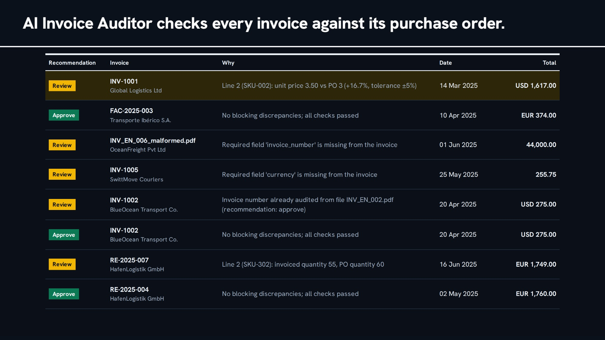

# AI Invoice Auditor

An AI-assisted accounts-payable system that reads invoices in several languages, checks them against an ERP and business rules, and recommends approve, review or reject. A person always makes the final decision, and every recommendation can be traced to the evidence behind it.

[](docs/demo.mp4)

**[Watch the 23-second demo](docs/demo.mp4)**, which uses sample invoices only.

**Live demo: [ai-invoice-auditor.netlify.app](https://ai-invoice-auditor.netlify.app).** The backend runs from my own computer, so the site only works while I have it running, and signing in needs an approved account. The video is always available.

> **Status: working prototype.** It works end to end on sample invoices, a mock ERP and free-tier services. It has not been used in production. See [from prototype to full scale](#9-from-prototype-to-full-scale) for what would change.

## Problems it solves

| Problem in accounts payable | How this project handles it |
|---|---|
| Matching each invoice against its purchase order (PO) by hand is slow and error-prone. | The workflow compares every line with the PO and vendor in the ERP and lists each mismatched field with both values. |
| Invoices arrive as PDF, Word and scans, in different languages. | Text is read with pdfplumber, OCR or python-docx. Non-English text is translated, and a person checks every translation. |
| Overcharges, wrong tax, currency mismatches, duplicate invoices and repeat billing on a PO slip through. | Fixed rules in `rules.yaml` check prices, quantities, tax, currency, arithmetic, duplicate numbers and repeat billing. |
| Finance teams can't easily ask questions across many invoices. | The Ask page answers counts and totals from SQL and other questions by RAG, with sources and a quality score. |
| An AI that approves payments on its own can't be trusted or audited. | Rules make the recommendation, not the model. A person decides, and the audit trail is append-only. |
| Documents can hide instructions aimed at the AI (prompt injection). | Questions are screened before the model, and invoice text that addresses the AI sends the invoice to a person. |

## At a glance

| | |
|---|---|
| **Problem** | Checking invoices by hand against purchase orders is slow and error-prone, but an AI that approves payments on its own can't be trusted or audited. |
| **Solution** | An LLM workflow handles the messy parts (translation, recovering missing fields, fuzzy line matching, summaries, questions). Fixed rules make the recommendation, and a reviewer makes the decision. |
| **Input** | PDF, Word and image files, including scans, by signed-in upload or a watched folder. The samples are in English, German and Spanish. |
| **Output** | A recommendation with per-field discrepancies, JSON and HTML reports, a permanent audit trail, and answers to questions with their sources. |
| **Status** | Working prototype: end to end on sample invoices and a mock ERP. Not used in production. |

## Highlights

- **Multi-agent workflow:** a checkpointed LangGraph pipeline of extraction, translation, data validation, ERP validation, reporting and indexing. A failed invoice resumes from the failed stage, so OCR and translation aren't repeated.
- **Agents across frameworks:** the LangGraph pipeline calls its tools over MCP (11 tools), and translation and reporting run as Google ADK agents in their own container, reached over A2A.
- **Self-correcting question answering:** a router sends structured questions to fixed SQL templates and the rest to RAG over Qdrant. Each RAG answer is scored on the RAG Triad, then the query is rewritten and retried up to 3 attempts if it scores too low.
- **Guardrails on AI output:** an AI translation, recovered field or line match always sends the invoice to a person, recovered values must be printed in the source, an AI line match can't cause a rejection, and the model never writes SQL.
- **Responsible-AI checks:** questions are screened before the model, invoice text that tries to instruct the AI goes to a person, and card and IBAN numbers are masked in answers.
- **Observability:** optional LangFuse tracing of every invoice run and question.
- **Human review and audit trail:** click-to-correct figures, re-validation as a new run, and append-only history. The database roles make it impossible for the application to delete audit records.
- **Security by default:** verified login on every data route, one least-privilege database role per service, row-level security, and untrusted files parsed in a separate process with no secrets and no network sockets.
- **Containerized and tested:** one command starts six health-checked services, and 124 automated tests include real sample files going through real parsing, OCR and the workflow.

## What's new

Added 2026-11-18:

- Google ADK translation and reporting agents served over A2A, in their own container.
- 11 MCP tools that the workflow and RAG nodes call.
- LangFuse Cloud tracing (optional).
- Responsible-AI guardrails on questions, invoice text and answers.
- A keyword fallback router for when the router model is unavailable.
- Per-task model settings (`llm.task_models`).
- A fixed-address public demo over a Tailscale Funnel.
- Its own Docker Compose project name (`aiinvoiceauditor`).

## Evidence: check these claims yourself

Numbers were last checked on 2026-11-18. Every claim below points to the code that enforces it and, where one exists, a test that fails if it breaks.

| Claim | Where it's enforced | Test or proof |
|---|---|---|
| **124 automated tests pass** (119 agent, 5 Mock ERP) | [`backend/Agent/tests`](backend/Agent/tests), [`backend/Mock-ERP/tests`](backend/Mock-ERP/tests) | Commands below |
| **Fixed rules make the recommendation, not the model** | `recommend()` in [`report.py`](backend/Agent/app/report.py), [`rules.yaml`](backend/configs/rules.yaml) | `test_every_sample_gets_its_documented_result` |
| **An AI translation always goes to a person** | `recommend()` in [`report.py`](backend/Agent/app/report.py) | `test_a_translated_invoice_goes_to_a_person_whatever_the_model_claims` |
| **Recovered values must be printed in the source** | `_printed_in_text()` in [`validation.py`](backend/Agent/app/validation.py) | `test_recovered_numbers_must_be_whole_printed_tokens`, `test_a_recovered_field_needs_review` |
| **An AI line match can't clear or cause a rejection** | `_match_lines()` in [`validation.py`](backend/Agent/app/validation.py) | `test_ai_line_match_never_clears_the_finding_on_its_own`, `test_every_ai_line_match_reply_gives_the_same_recommendation` |
| **The model never writes SQL** | `structured_query()` in [`repository.py`](backend/Agent/app/repository.py): the model only picks a fixed query | Read the function; it has no SQL input from the model |
| **A failed invoice resumes from the failed stage** | `build_graph()` and `resume()` in [`workflow.py`](backend/Agent/app/workflow.py) | `test_a_failure_is_recorded_and_a_retry_resumes_from_that_stage` |
| **Reads PDF, Word and scanned files in 3 languages** | [`extraction.py`](backend/Agent/app/extraction.py), `eng+deu+spa` in [`agent.yaml`](backend/configs/agent.yaml), [sample invoices](data/incoming) | `test_every_sample_gets_its_documented_result`, `test_a_scanned_copy_is_read_by_ocr_and_flagged_as_a_duplicate` |
| **Answers are scored and retried up to 3 attempts** | `reflect_node()` and `rewrite_query()` in [`rag/graph.py`](backend/Agent/app/rag/graph.py), threshold in [`agent.yaml`](backend/configs/agent.yaml) | Shown on each answer in the Ask page; no automated test uses a real model |
| **Untrusted files are parsed in a limited process** | Seccomp filter and limits in [`extraction.py`](backend/Agent/app/extraction.py) | `test_parsers_cannot_open_network_connections`, `test_real_sample_parses_in_a_child_with_no_secrets`, `test_slow_parser_is_stopped_at_the_deadline` |
| **The application can't delete audit history** | Grants in [`setup.sql`](backend/Database/supabase/setup.sql), policies in [`setup_rls.sql`](backend/Database/supabase/setup_rls.sql) | [Database checks in section 10](#verifying-it), run against a real database |
| **Every data route needs a login** | `current_reviewer()` in [`auth.py`](backend/Agent/app/auth.py) | `test_every_route_except_health_requires_login` |
| **An invoice that instructs the AI goes to a person** | `check_data()` in [`workflow.py`](backend/Agent/app/workflow.py), [`guardrails.py`](backend/Agent/app/guardrails.py) | `test_an_invoice_that_instructs_the_ai_goes_to_a_person`, [`test_guardrails.py`](backend/Agent/tests/test_guardrails.py) |
| **MCP tools aren't publicly reachable** | `HOST` in [`mcp_server.py`](backend/Agent/app/mcp_server.py) binds to 127.0.0.1 inside the container, with no published port | `curl 127.0.0.1:8000/mcp/` returns 404 |
| **Six health-checked services** | [`compose.yaml`](compose.yaml) | `docker compose ps` |
| **Works end to end** | [Demo video](docs/demo.mp4), [expected sample results](#expected-results-on-the-sample-invoices) | Live checks on 2026-11-18 (below); sample invoices and a mock ERP only |
| **No secret values leaked** | `.env` is git-ignored and passed only at runtime | Checked 2026-11-18: none of the 13 `.env` secret values appear in git history, Netlify files, Docker layers or container logs |

**What this doesn't prove:** this is a prototype that hasn't been used in production. The automated tests use stand-ins for the database, ERP and Gemini, so SQL and real AI replies aren't covered by them. There's no CI on this repository, so the tests are run by hand, and there's no measured accuracy figure for the question answering. See [known limitations](#12-known-limitations).

## How it was tested

### Automated tests (124 pass)

They need no database, Gemini access or network.

- **Pipeline (19 tests):** real sample files go through real parsing, OCR, language detection, validation, reporting and the LangGraph workflow. Every node calls its MCP tool over an in-memory MCP connection. The database, ERP, Gemini and search index are stand-ins. These tests also pass with tracing switched on.
- **Security and rules (89 tests):** login, API access, rate limits, file handling, prompt handling and business rules.
- **Guardrails and keyword router (11 tests):** question screening, prompt-injection detection, card and IBAN masking, and the keyword router.
- **Mock ERP (5 tests):** service token and data access.

Run them from the repository root:

```bash
docker build -t aiinvoiceauditor/agent:1.0 ./backend/Agent

# 119 agent tests
docker run --rm --network none -v "$PWD/backend/Agent/tests:/app/tests:ro" \
  -v "$PWD/backend/configs:/app/configs:ro" -v "$PWD/data/incoming:/data/incoming:ro" \
  aiinvoiceauditor/agent:1.0 python -m unittest discover -s tests

# 5 Mock ERP tests
docker run --rm --network none -w /mock -v "$PWD/backend/Mock-ERP/app:/mock/app:ro" \
  -v "$PWD/backend/Mock-ERP/tests:/mock/tests:ro" aiinvoiceauditor/agent:1.0 python -m unittest discover -s tests
```

### Live end-to-end checks (2026-11-18)

Run against the real stack (Supabase, real Gemini, LangFuse Cloud) through the hosted site, with a real login and a headless browser (Playwright).

- **Sign-in** works.
- **Invoices page** loads 11 invoices: 1 reject, 9 review, 1 approve.
- **Processing log:** the "Agents and tools" panel lists 2 A2A agents, 11 MCP tools and "Tracing: on".
- **Ask:** a prompt-injection question is refused before any model call. "How many invoices were rejected?" is answered from SQL ("Invoices: 1"). "Why was INV-1001 flagged?" is answered by RAG (line 2 unit price 3.50 vs PO 3, +16.7% over the ±5% tolerance) with a quality score of 1.00 and its source.
- **Review:** re-checking INV-1001 produced run 8, with a new summary written by the ADK reporting agent over A2A.
- **LangFuse Cloud** received the traces: node spans, `mcp:*` tool spans, Gemini generations, embeddings and RAG Triad scores.
- **Access:** data routes return 401 without a login, and the MCP endpoint returns 404 from outside.
- **Browser:** no console errors from the app.

Security checks the same day: none of the 13 secret values in `.env` appear anywhere in git history on any branch, in the files Netlify serves, in Docker image layers or settings, or in container logs. `.env` was never committed.

## Tech stack

| Area | Technologies |
|---|---|
| Backend | Python 3.11, FastAPI, Pydantic, Uvicorn |
| AI and agents | LangGraph, Google ADK, A2A, MCP, LangChain text splitters, LiteLLM, Google Gemini (chat and embeddings), RAG with RAG Triad scoring, LangFuse tracing via the OpenTelemetry-based SDK (optional) |
| Document processing | pdfplumber, Tesseract OCR, Poppler, python-docx, langdetect |
| Data | PostgreSQL on Supabase (row-level security), Qdrant vector database, Redis cache, Supabase Storage |
| Frontend | React 19, TypeScript, Vite, TanStack Query, React Router, Supabase Auth |
| Infrastructure | Docker Compose, nginx, Netlify, Tailscale Funnel |
| Testing | unittest, in-memory MCP connections, Playwright |

### Skills demonstrated

- **AI engineering:** multi-agent design with LangGraph and Google ADK, the A2A protocol, an MCP server and client, RAG with self-correction and RAG Triad evaluation, LLM guardrails and prompt-injection defence, LLM observability with LangFuse and OpenTelemetry, prompt design, and cost control with caching, daily caps and per-task models.
- **Backend:** FastAPI, Pydantic, async code and threads, background jobs.
- **Data:** PostgreSQL on Supabase, row-level security, least-privilege roles, Qdrant, Redis.
- **Document processing:** pdfplumber, Tesseract OCR, Poppler, python-docx, langdetect.
- **Frontend:** React 19, TypeScript, Vite, TanStack Query, Supabase Auth.
- **DevOps and security:** Docker Compose, multi-network isolation, sandboxed parsing with seccomp, Netlify, Tailscale Funnel, secret hygiene.
- **Testing:** unittest, in-memory MCP, Playwright end-to-end checks.

---

## 1. Architecture

```
                         Docker Compose networks
 ┌──────────────────────────────────────────────────────────────────────────────────────┐
 │  upload or ./data/incoming ──► agent :8000 ──HTTP──► mock-erp :8000 ──► Supabase     │
 │                                  │  LangGraph workflow        (erp schema, read-only)  │
 │                                  │  monitor → extract → translate → validate →         │
 │                                  │  business-validate → report → index                 │
 │                                  ├──► Supabase         langgraph + audit schemas       │
 │                                  ├──► qdrant   :6333   RAG index (derived)             │
 │                                  ├──► redis    :6379   LLM / translation cache         │
 │                                  ├──► adk-agents :8002 (A2A; own network adk-net)      │
 │                                  │      ADK translation + reporting agents             │
 │                                  ├──► MCP tools 127.0.0.1:8100 (inside the agent only) │
 │                                  └──► Gemini API (outside the network, via LiteLLM)    │
 │  frontend :3000 (nginx) ──/api──► agent :8000; login with Supabase Auth                │
 │  demo profile only:  internet ──► tunnel (Tailscale Funnel, on demo-net) ──► agent     │
 │                      publisher ──► Netlify site, pointed at the Funnel address         │
 └──────────────────────────────────────────────────────────────────────────────────────┘
   host ports (127.0.0.1 only): agent 8000, mock-erp 8001→8000, frontend 3000, qdrant 6333 (redis and adk-agents have no host port, and only the agent can reach them)
```

| Service | Image | Responsibility |
|---|---|---|
| agent | `aiinvoiceauditor/agent:1.0` | Monitor, extraction, translation, validation, reporting and RAG agents, and the API for the UI |
| mock-erp | `aiinvoiceauditor/mock-erp:1.0` | `GET /po/{po}`, `/vendor/{id}`, `/sku/{code}` from the `erp` schema, with a service token |
| frontend | `aiinvoiceauditor/frontend:1.0` | Auditor UI; proxies `/api` to the agent |
| qdrant | `qdrant/qdrant:v1.20.0` | Vector index (named volume) |
| adk-agents | `aiinvoiceauditor/adk-agents:1.0` | Google ADK `translation_agent` and `reporting_agent` served over A2A on port 8002; stateless, on `adk-net` shared only with the agent |
| redis | `redis:7.4.12` | Disposable cache (no persistence) |
| tunnel (demo profile) | `tailscale/tailscale:v1.104.4` | Tailscale Funnel: a fixed public HTTPS address that proxies to `agent:8000` only |
| publisher (demo profile) | `aiinvoiceauditor/publisher:1.0` | Builds the frontend and deploys it to Netlify, pointed at the Funnel address |

The six core services are agent, mock-erp, frontend, qdrant, adk-agents and redis. Networks are `invoice-net`, `cache-net` (internal), `adk-net` and `demo-net`.

**Public demo:** the optional `demo` Compose profile adds the two extra services above. `tunnel` is a Tailscale Funnel that gives the agent a fixed public HTTPS address and reconnects by itself, and `publisher` deploys the built frontend to Netlify pointing at that address. The API is reachable only while the demo runs, and login is still required. The tunnel runs without extra privileges and can reach only the agent.

### Boundaries are enforced by database privileges, not convention

`backend/Database/supabase/setup.sql` creates one role per service, and `setup_rls.sql` adds matching row-level security policies. The frontend has no database role:

| Role | `erp` | `audit` | `langgraph` |
|---|---|---|---|
| agent | **none** | SELECT, INSERT, and UPDATE on only the pipeline's columns of `invoice_audit` and `validation_runs`; no DELETE | can create tables |
| mock-erp | SELECT | none | none |

So the agent *cannot* bypass the mock-erp API, the browser never touches the database, and the application can't delete audit history. Extracted line items and discrepancies are immutable, and `human_feedback` rows can only be marked as used by a re-validation.

### Models

| Task | Model (Gemini API via LiteLLM) |
|---|---|
| Translation, field recovery, line matching, report summary, RAG generation, RAG reflection, query routing | `gemini-3.5-flash-lite` |
| Embeddings (Qdrant collection: 3072 dims, cosine) | `gemini-embedding-001` |

Each task's model is set under `llm.task_models` in `agent.yaml`, and all of them are `gemini-3.5-flash-lite` now. If a task's model fails, that call falls back to `chat_model`, and `CHAT_MODEL` in `.env` moves every task still on the default. The ADK agents read the same `agent.yaml` and `prompts.yaml`.

This build uses the Gemini API free tier so that it runs at no cost, with a daily call limit so nothing can use up the quota. Model IDs are configuration (`backend/configs/agent.yaml`, or `.env` overrides), and LiteLLM makes the provider replaceable. Changing the embedding model may also mean changing `embedding_dimensions` and recreating the Qdrant collection.

---

## 2. Processing pipeline

```
START ─┬─► extract_pdf ───┐
       ├─► extract_docx ──┼─► translate ─► validate_data ─► validate_business ─► report ─► index ─► END
       ├─► extract_image ─┘                     ▲
       └─► (re-validation) ─────────────────────┘
```

1. **Monitor** (no LLM). Picks up uploads and polls `/data/incoming`, computing the SHA-256 of each file's content. Files already in `audit.invoice_audit` are skipped, so renamed duplicates are caught. Every detected file gets a row, including unsupported and failing ones. The claim is `INSERT … ON CONFLICT (file_checksum) DO NOTHING`, so the same file is never processed twice. `<name>.meta.json` sidecars are stored as `email_metadata`.
2. **Extractor** (no LLM). Per PDF page: pdfplumber first; a page with fewer than 20 characters has no text layer, so it is rendered with Poppler and OCR'd with Tesseract (`eng+deu+spa`, preprocessed). DOCX: paragraphs and tables. Images: Tesseract. The full raw text is stored; parsed header fields go into typed columns, line items become rows, and everything else labelled goes into `extracted_raw` (JSONB).
3. **Translation**. Detects the language (langdetect, with the sidecar hint). English is passed through at confidence 1.0. Other languages are translated by Gemini and cached in Redis. Confidence = min(model's self-score, share of numbers preserved in the translation). It's shown to the reviewer, and a translated invoice always goes to Review.
4. **Invoice data validation**. Checks required fields, types, accepted currencies and the invoice's own arithmetic (line totals, subtotal, tax, total) against `backend/configs/rules.yaml`, and flags duplicate invoice numbers and repeat billing on a PO, using reviewers' corrections. For missing header fields it asks the LLM, but keeps a value only if it is printed in the text, and a person must confirm it.
5. **Business validation**. Calls `mock-erp:8000` over HTTP: PO, vendor, SKU. Lines are matched by item code, then by description similarity, then by the LLM. It compares quantity, unit price (±5%, rejecting at over 50% above the PO), currency and tax rate, and writes one discrepancy row per mismatched field with both values and the deviation.
6. **Reporting**. The recommendation (approve / review / reject) is computed from the policies in `rules.yaml`, not by the model. Gemini writes the summary. The JSON report, HTML report and outcome go to PostgreSQL (system of record) and to the `reports_data` volume.
7. **Indexing**. Reads the stored text and the latest report back **from PostgreSQL**, chunks it (LangChain text splitter), embeds it with Gemini, and upserts to Qdrant with payload `invoice_id, chunk_text, source_type, vendor, language, …`.

Each node writes its own results. If a node fails (throttling, mock-erp down), the invoice is marked `failed` at that stage and later **resumed from its LangGraph checkpoint**, so OCR and translation are never repeated. The monitor retries up to 3 times with backoff, and the frontend has a retry button.

### Expected results on the sample invoices

| File | Result | Why |
|---|---|---|
| INV_EN_001.pdf | Review | SKU-002 unit price 3.50 vs PO 3.00 (+16.7%) |
| INV_EN_002.pdf | Approve | No item code, matched to PO line by description |
| INV_ES_003.pdf | Review | Spanish, matches PO-1003; a person checks the AI translation |
| INV_DE_004.pdf | Review | German, matches PO-1004; a person checks the AI translation |
| INV_EN_005_scan.png | Review | OCR; no currency printed, and tax is stated without a rate, so it stays Review until both are resolved |
| INV_EN_006_malformed.pdf | Review | Invoice number and currency missing |
| INV_DE_007.docx | Review | DOCX path; quantity 55 vs PO 60 |
| INV_EN_002_scanned.pdf | Review | Image-only PDF: shows the OCR fallback (same content as INV_EN_002, different checksum, flagged as duplicate invoice number) |

---

## 3. Question answering (RAG)

```
route ─► sql_answer ─────────────────────────────────────────────► END   (structured questions)
  └────► retrieve ─► augment ─► generate ─► reflect ─┬ avg > 0.7 ─► finalize ─► END
            ▲                                         ├ 3 attempts ► finalize (best answer, flagged)
            └──────────── rewrite_query ◄─────────────┘ otherwise
```

- **Structured questions** ("how many invoices were rejected", "total per currency") are answered from PostgreSQL. The model only chooses one of four fixed, parameterised query templates; it never writes SQL.
- **Retrieval agent**: Gemini embedding plus Qdrant search, optionally filtered to one invoice.
- **Augmentation agent**: rerank (0.7 × vector score + 0.3 × query-term coverage; report chunks boosted for "why/flagged" questions), deduplicate, and assemble numbered context.
- **Generation agent**: Gemini answers only from the context, with citations.
- **Reflection agent**: RAG Triad (answer relevance, groundedness, context relevance). The answer is shown if the average is above 0.7. Otherwise the query is rewritten, the search widened, and retrieval repeated, up to 3 attempts in total.
- **Caching**: a repeated question is answered from Redis (`rag:{sha256}`), and every model call is cached under `llm:{sha256(model + prompt)}`.

---

## 4. Agents, tools and tracing

- **A2A (agent to agent):** translation and reporting are Google ADK agents (`translation_agent`, `reporting_agent`) in the `adk-agents` container, using Gemini natively through google-genai. They are served over A2A (protocol v1.0, JSON-RPC `SendMessage`) on port 8002, with no host port, on `adk-net`, which only the agent shares. They are stateless. The agent caches every reply in Redis, counts each call toward the daily Gemini limit, and falls back to an in-process LiteLLM call if the container is down.
- **MCP (tools):** the agent serves 11 tools on `127.0.0.1:8100/mcp/` inside its container: `invoice-watcher`, `data-harvester`, `lang-bridge`, `data-completeness-checker`, `business-validation`, `insight-reporter`, `vector-indexer`, `semantic-retriever`, `chunk-ranker`, `response-synthesizer` and `rag-evaluator`. The port is never published, so the frontend and the demo tunnel can't reach it. Workflow and RAG nodes call the tools over MCP. Tools compute and return JSON, and the nodes persist, so every audit write stays in the nodes. `invoice-watcher` is read-only. `GET /agents` (login required) lists the A2A cards, MCP tools and tracing status, and the Processing log shows them in the "Agents and tools" panel.
- **Guardrails:** a question is refused before any model call if it is empty, over 1000 characters or looks like prompt injection, and its route is `guardrail`. Invoice text that addresses the AI adds an `rai_guardrail` discrepancy, which sends the invoice to manual review and never to auto-approval. IBANs and Luhn-valid card numbers are masked in answers and sources, and the personas tell the model that document text is data.
- **Keyword fallback:** if the router model is unavailable, a keyword router answers count, list, total and discrepancy questions from SQL, and why or explain questions go to RAG.
- **LangFuse tracing (optional):** off when the keys are empty. It records one trace per invoice run and per question, with node spans, MCP tool spans nested through MCP `_meta`, Gemini generations and embeddings with token usage, and RAG Triad scores. It uses the OpenTelemetry-based LangFuse SDK (v5), which is what LangFuse Cloud accepts.

To turn tracing on:

1. Create a free LangFuse Cloud account (Hobby plan) and a project.
2. Copy the project's public and secret keys.
3. Set `LANGFUSE_PUBLIC_KEY` and `LANGFUSE_SECRET_KEY` in `.env`. Outside the EU region, also set `LANGFUSE_HOST` (or `LANGFUSE_BASE_URL`) to the address your project uses, such as `https://us.cloud.langfuse.com`.
4. Run `docker compose up -d` again and check that `GET /agents` shows tracing as on.

Traces include invoice text and prompts, and LangFuse stores them, so use sample invoices only.

---

## 5. Human review frontend

- **Invoices**: how many invoices need a decision, money held per currency, decision progress, and a proportional Reject / Review / Approve strip that also filters. A searchable vendor menu shows recently used vendors first, then all vendors with the most flagged first. Each row shows why it was flagged, and hovering shows its problems. Keyboard: `/` search, `J` and `K` move, `Enter` opens.
- **Review**:
  - The verdict and reason fill the top of the page, followed by the AI summary.
  - Each problem shows invoice, ERP and expected values, a to-scale comparison where the values are numeric, and jumps to its line when clicked. Line items carry check and cross marks.
  - Click any figure to correct it. Each correction is a new `human_feedback` row, and the original stays visible, struck through.
  - **Re-check** layers the latest correction per field over the original extraction and runs validation, business validation, report and index again as a new run.
  - The decision bar stays on screen. A first decision opens the next undecided invoice; changing an earlier decision stays on the page. A decision applies to the latest run, so it's refused while a re-check is running or if the page is out of date.
  - The full report opens in a sandboxed frame. Document text and change history fold out.
- **Ask**: questions scoped to all invoices or one. Each answer shows linked sources, quality scores and attempts.
- **Processing log**: every detected file, failures with their stage and error, retry, scan now, rebuild index, service health.
- **Themes**: light and dark, with a switch. Design decisions are in `DESIGN.md` and product context in `PRODUCT.md`.

---

## 6. Data placement

| Store | Holds | Survives `down` | Survives `down -v` |
|---|---|---|---|
| `./data/incoming` (bind mount, read-only) | Sample and watched-folder invoice files | yes | yes (host folder) |
| Supabase Storage (private bucket) | Uploaded invoice files, under random names | yes | yes (not a local volume) |
| `reports_data` volume | Generated JSON/HTML report files | yes | no |
| Supabase PostgreSQL (hosted) | `erp` master data, `audit` trail, `langgraph` checkpoints, login accounts | yes | yes (not a local volume) |
| Qdrant `qdrant_data` | Embeddings + chunk payloads (derived) | yes | no |
| Redis (no volume) | LLM, translation, embedding, answer caches with TTLs | no, by design | no |

`audit` schema (`backend/Database/supabase/setup.sql`):

- `invoice_audit`: file path + checksum (never the file), raw and translated text, typed header fields (`NUMERIC`, `DATE`), `extracted_raw` JSONB, status, recommendation, `thread_id`.
- `invoice_line_items`: one row per line.
- `validation_runs`: one row per validation (initial and each re-validation), with the JSON and HTML report, so history is never overwritten.
- `discrepancies`: one row per mismatched field per run.
- `human_feedback`: append-only corrections, decisions and comments.

If the Qdrant volume is lost, the agent detects an empty collection on startup and rebuilds it from Supabase (or use **Processing log → Rebuild search index**). No file is re-read and no OCR is repeated.

---

## 7. Security

- **Login:** every API route except a bare `/health` needs a Supabase login, verified against the project's public signing keys, and only accounts in `REVIEWER_EMAILS` are accepted. The reviewer recorded on each change comes from the verified token. Public sign-up is off.
- **Least privilege:** each service has its own database role and secrets. Row-level security is on, the application can't delete from the audit trail, and browser API roles get no access to the data.
- **Between services:** Mock ERP needs a service token, Qdrant an API key and Redis a password, and placeholder secrets stop startup. Database connections verify the server's certificate.
- **Uploads:** a private Storage bucket, reached only through the signed-in API. Each file's real type is checked and it gets a random name.
- **Untrusted files:** parsing runs in a separate process with no secrets, a memory limit, a deadline and a seccomp filter that blocks opening sockets. File size, page and pixel limits are enforced.
- **AI output is never trusted alone:** recommendations come from fixed rules. An AI translation, recovered field or line match always sends the invoice to a person, an AI line match can't cause a rejection, and the model never writes SQL. A recovered amount or PO number can still bring an invoice under a rule that rejects it, and a person makes the final decision either way.
- **Abuse limits:** per-reviewer rate limits on costly actions, a daily Gemini call limit and a request size limit in the API.
- **Browser:** Content Security Policy on both frontends, with HSTS on Netlify, and reports shown in a sandboxed frame.
- **Dependencies:** pinned in lockfiles and scanned with `pip-audit` and `npm audit`.

An AI-assisted source-level security audit confirmed 3 low-severity issues and no high or medium ones, and all 3 were fixed with regression tests. It used source review and sandboxed local checks, so it wasn't a professional penetration test and didn't probe the live site.

---

## 8. Design decisions

- **Why a checksum, not a filename?** Vendors rename files, and the same invoice can arrive twice. The content hash is the identity, and the UNIQUE constraint makes the claim atomic.
- **Why an audit schema when LangGraph already checkpoints?** Checkpoints are serialized working memory for resuming a workflow, and they can be pruned. The audit trail is a typed, indexed business record that is never pruned. ("Show every rejected invoice from vendor X last month" is a SQL query; it can't be answered from msgpack blobs.)
- **What scales horizontally?**
  - mock-erp and frontend are stateless and scale freely.
  - The agent's API and workflow could scale too: the checksum claim stops two replicas from processing the same file, and state is in Supabase. Today's in-memory rate limits and single-agent restart recovery would need changing first, and the folder poller would make every replica scan the same mount. In production, ingestion would be an object-storage event queue (S3 → SQS) consumed by N workers.
  - The Supabase database is the single writer of record. Each open connection uses a pooler slot, so the pools are kept small.
  - Qdrant can be clustered. Redis is a single cache node.
- **Why doesn't a restart policy fix startup ordering?** Restarting a service that starts before its database only produces a crash loop that hides the real problem. Ordering comes from `depends_on: condition: service_healthy` plus health checks that test real readiness. Application services use `on-failure:3`, so a genuine failure ends as *Exited* in `docker compose ps` instead of looping forever.
- **Why object storage for uploads?** A host bind mount ties the agent to one machine, has no versioning or access control, and doesn't produce reliable change events. The watched folder stays for the samples.
- **LiteLLM in-process vs. gateway:** in-process is simpler (one container fewer, no extra hop). As a separate gateway service, rate limiting, cost tracking, model routing and credential handling would be centralised, and the agent would not need the Gemini API key at all.
- **Redis test:** flushing Redis only makes the system slower (cache misses re-call Gemini). Nothing durable lives there.
- **Money and dates:** `NUMERIC` and `DATE`/`TIMESTAMPTZ` in PostgreSQL; `Decimal` in Python; amounts are passed as strings in workflow state.

---

## 9. From prototype to full scale

These are the next steps, not things already done. Today the project is limited by free tiers and a single computer.

| Limit today | What to change |
|---|---|
| Gemini free tier, with a daily cap | Move to a paid tier, then raise `llm.max_calls_per_day` and `rate_limits` in `agent.yaml`. |
| Supabase free plan | Move to Pro for backups, more storage and more connections. |
| Backend runs on the author's laptop, exposed by a Tailscale Funnel | Run it on a cloud container host. The Compose services move as they are. |
| `mock-erp` | Replace it with a real ERP API behind the same `erp_client` interface. |
| Watched folder and uploads | Add email ingestion. |
| Self-hosted single Qdrant | Use managed or replicated Qdrant. |
| LangFuse Cloud Hobby plan | Use a paid plan, or self-host it for data residency. |
| Per-reviewer rate limits held in memory | Move them to a shared store before running several agent replicas. |
| No accuracy figure | Measure accuracy on a labelled set of real invoices. |

---

## 10. Run it yourself

Prerequisites: Docker Desktop (Compose v2), a Supabase project, and a free Gemini API key from [Google AI Studio](https://aistudio.google.com/apikey). The free tier has rate limits. Google may use free-tier data to improve its products, and people may read it, so use sample invoices only.

```bash
# First create a Supabase project, turn off public sign-ups, add a user, and run
# backend/Database/supabase/setup.sql then setup_rls.sql in its SQL Editor.
cp .env.example .env            # then edit .env: Supabase values, role passwords, GEMINI_API_KEY,
                                # REVIEWER_EMAILS and the three generated service secrets
docker compose up --build -d
docker compose ps               # wait until all six services show (healthy)
```

| Open | URL |
|---|---|
| Auditor frontend | http://localhost:3000 |
| Qdrant dashboard (asks for `QDRANT_API_KEY`) | http://localhost:6333/dashboard |

Sign in with a user created in Supabase under **Authentication → Users**. Invoices in `data/incoming/` are picked up automatically within about 20 seconds (a file must be unchanged across two scans).

### Uploading invoices

Click **Upload invoice** on the dashboard. PDF, Word (.docx), PNG, JPEG and TIFF files up to 25 MB are accepted.

To turn uploads on, create a **private** Supabase Storage bucket named `invoices`, then copy the values under **Storage → S3 Configuration** into the `SUPABASE_S3_*` settings in `.env`. Without them, the button explains that uploads aren't set up.

### Configuring `.env`

| Variable | Used by | Purpose |
|---|---|---|
| `SUPABASE_URL`, `SUPABASE_PUBLISHABLE_KEY` | agent, frontend | Login. Both are public values; the agent only uses the URL, to fetch signing keys |
| `SUPABASE_DB_HOST`, `SUPABASE_DB_PORT`, `SUPABASE_PROJECT_REF` | agent, mock-erp | Session pooler connection |
| `AGENT_DB_USER` / `_PASSWORD` | agent | Role that writes `audit` and creates tables in `langgraph` |
| `ERP_DB_USER` / `_PASSWORD` | mock-erp | Read-only role on the `erp` schema |
| `GEMINI_API_KEY` | agent | Gemini API via LiteLLM |
| `LANGFUSE_PUBLIC_KEY`, `LANGFUSE_SECRET_KEY`, `LANGFUSE_HOST` | agent | Optional tracing (see section 4) |
| `CHAT_MODEL`, `EMBED_MODEL` | agent, adk-agents (`CHAT_MODEL` only) | Optional model overrides (e.g. `gemini/gemini-3.5-flash-lite`) |

Role passwords are set when `setup.sql` runs. To change one later, run `ALTER ROLE ... PASSWORD` in the Supabase SQL Editor and update `.env`.

The LangFuse keys (`LANGFUSE_PUBLIC_KEY`, `LANGFUSE_SECRET_KEY`, optional `LANGFUSE_HOST`) are optional. Leave them empty to run without tracing.

`.env` is excluded by `.gitignore` and by every `.dockerignore`, and is only passed to containers at runtime, each service getting only the variables listed for it in `compose.yaml`. Never commit it.

### Optional public demo

Set these in `.env`, then `docker compose up -d` starts the extra services. Stopping the project closes the public address.

| Variable | Purpose |
|---|---|
| `COMPOSE_PROFILES=demo` | Turns on the `tunnel` and `publisher` services |
| `TS_AUTHKEY`, `TS_HOSTNAME` | Tailscale auth key, and the machine name that forms the address |
| `DEMO_BACKEND_URL` | The Funnel address, like `https://invoice-auditor.tail1234.ts.net` |
| `NETLIFY_SITE_ID`, `NETLIFY_AUTH_TOKEN` | The Netlify site to publish to. The token can reach every site on the account |

In Tailscale, turn on MagicDNS and HTTPS certificates under DNS, and give the node the `funnel` attribute in the access policy. Login is still required on the public address.

### Verifying it

```bash
# 1. Single-command startup
docker compose up --build -d
docker compose ps                         # six services, all (healthy)

# 2. End-to-end processing
docker compose logs -f agent              # extract → translate → validate → report → index
#   then in the Supabase SQL Editor:
#   SELECT file_name, extraction_method, source_language, recommendation FROM audit.invoice_audit;

# 3. Persistence across restart
docker compose down
docker compose up -d
#   the frontend still lists every invoice; Ask still answers about them; nothing is reprocessed

# 4. Deliberate loss of local volumes (-v deletes Qdrant and report files, not Supabase)
docker compose down -v
docker compose up -d
#   the audit trail is intact, and the agent rebuilds the search index from it on startup

# 5. No secrets in images
docker history aiinvoiceauditor/agent:1.0 --no-trunc

# 6. Mock ERP refuses a request with no service token
docker compose exec agent python -c "import httpx; print(httpx.get('http://mock-erp:8000/po/PO-1001').status_code)"   # 401

# 7. The API refuses requests without a login
curl -i http://localhost:8000/invoices    # 401

# 8. The agent can't read the ERP schema directly
docker compose exec agent python -c "import psycopg; from app.settings import settings; psycopg.connect(settings().conninfo()).execute('SELECT * FROM erp.vendors')"
#   psycopg.errors.InsufficientPrivilege: permission denied for schema erp
```

---

## 11. Repository layout

```
compose.yaml                 six services plus the optional demo profile, volumes, networks, health checks
demo/tailscale-serve.json    Funnel config: public HTTPS to agent:8000 only
.env.example                 configuration template (copy to .env)
backend/
  configs/
    rules.yaml               validation rules, tolerances, policies
    agent.yaml               monitor / OCR / model / cache / rate limit / RAG settings
    prompts.yaml             personas and prompt templates
  Database/supabase/         run once in the Supabase SQL Editor
    setup.sql                schemas, tables, ERP seed data, service roles and grants
    setup_rls.sql            row-level security policies matching the grants
  Agent/                     agent image
    app/main.py              FastAPI: health, invoices, upload, feedback, revalidate, query, retry, reindex
    app/auth.py              login token verification
    app/monitor_agent.py     upload and folder monitor
    app/uploads.py           upload checks, app/storage.py private bucket access
    app/extraction.py        pdfplumber / Tesseract / python-docx, in a limited child process
    app/parsing.py           multilingual field + line-item parsing
    app/translate.py         translation agent
    app/validation.py        data + business validation agents
    app/report.py            reporting agent (+ templates/report.html.j2)
    app/workflow.py          LangGraph invoice workflow + checkpointer
    app/mcp_server.py        the 11 MCP tools (loopback only), app/mcp_client.py calls them
    app/a2a_client.py        calls the ADK agents over A2A, with cache and LiteLLM fallback
    app/guardrails.py        question screening, injection detection, PII masking
    app/tracing.py           optional LangFuse tracing
    app/rag/keyword_router.py  fallback router when the router model is unavailable
    app/rag/                 indexing, retrieval, augmentation, generation, reflection, graph
    app/repository.py        all audit-schema SQL
    tests/                   pipeline and security tests, plus test_guardrails.py and test_keyword_router.py
  ADK-Agents/                adk-agents image (Google ADK translation and reporting agents over A2A)
  Mock-ERP/                  mock-erp image (FastAPI over erp schema) and its tests
  certs/                     Supabase CA, for verifying database connections
frontend/                    React + Vite + TypeScript auditor UI, nginx config, Netlify config, demo publishing script
data/incoming/               sample invoices (watched folder)
docs/                        demo video
PRODUCT.md, DESIGN.md        product context and design decisions
```

Each service has `requirements.txt` (direct dependencies) and `requirements.lock` (every transitive package pinned; the Dockerfiles install from the lock for reproducible builds).

---

## 12. Known limitations

- It uses sample invoices and a mock ERP, and the public demo runs from one computer. A real deployment would need its own hosting and security review.
- The test suite uses stand-ins, so SQL and real AI replies aren't covered by automated tests.
- The frontend loads the newest 500 invoices. Larger volumes need paging, filtering and totals in SQL.
- Reviewer corrections feed re-checks and the repeat-billing and duplicate checks, but the invoice list, structured answers and search labels still show values as extracted.
- Invoice text can still influence AI answers and summaries, and the parsers share the agent's operating-system user.
- Per-reviewer rate limits are held in memory, so a restart resets them.
- An invoice list open in another window can show an old decision until it refreshes. Stored data isn't affected.
- Invoice text is sent to Gemini and stored on Supabase, so check both providers' data terms before using real invoices.
- The guardrails are pattern-based, so a carefully worded injection can get past them.
- The public demo only works while the author's computer is on.
- Calls to the ADK agents are traced from the agent's side (prompt and reply), without token usage.
- With LangFuse enabled, invoice text and prompts go to LangFuse Cloud, so check its data terms before using real invoices.
- A signed-out access token works until it expires, so keep its lifetime short.
