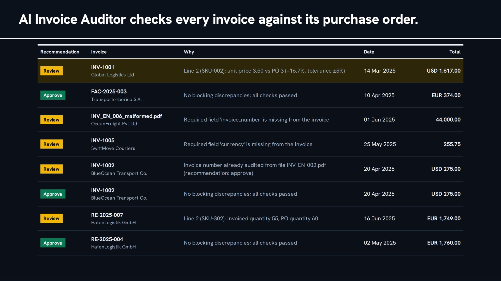

# AI Invoice Auditor

An AI-assisted accounts-payable system that reads invoices in several languages, checks them against an ERP and business rules, and recommends approve, review or reject. A person always makes the final decision, and every recommendation can be traced to the evidence behind it.

[](docs/demo.mp4)

**[Watch the 23-second demo](docs/demo.mp4)**, which uses sample invoices only.

**Live demo: [ai-invoice-auditor.netlify.app](https://ai-invoice-auditor.netlify.app).** The backend runs from my own computer, so the site only works while I have it running, and signing in needs an approved account. The video is always available.

## At a glance

| | |
|---|---|
| **Problem** | Checking invoices by hand against purchase orders is slow and error-prone, but an AI that approves payments on its own can't be trusted or audited. |
| **Solution** | An LLM workflow handles the messy parts (translation, recovering missing fields, fuzzy line matching, summaries, questions). Fixed rules make the recommendation, and a reviewer makes the decision. |
| **Input** | PDF, Word and image files, including scans, by signed-in upload or a watched folder. The samples are in English, German and Spanish. |
| **Output** | A recommendation with per-field discrepancies, JSON and HTML reports, a permanent audit trail, and answers to questions with their sources. |
| **Status** | Working end to end, using sample invoices and a mock ERP. It's a portfolio project and hasn't been used in production. |

## Highlights

- **Multi-agent workflow:** a checkpointed LangGraph pipeline of extraction, translation, data validation, ERP validation, reporting and indexing. A failed invoice resumes from the failed stage, so OCR and translation aren't repeated.
- **Self-correcting question answering:** a router sends structured questions to fixed SQL templates and the rest to RAG over Qdrant. Each RAG answer is scored on the RAG Triad, then the query is rewritten and retried up to 3 attempts if it scores too low.
- **Guardrails on AI output:** an AI translation, recovered field or line match always sends the invoice to a person, recovered values must be printed in the source, an AI line match can't cause a rejection, and the model never writes SQL.
- **Human review and audit trail:** click-to-correct figures, re-validation as a new run, and append-only history. The database roles make it impossible for the application to delete audit records.
- **Security by default:** verified login on every data route, one least-privilege database role per service, row-level security, and untrusted files parsed in a separate process with no secrets and no network sockets.
- **Containerized and tested:** one command starts five health-checked services, and 110 automated tests include real sample files going through real parsing, OCR and the workflow.

## Tech stack

| Area | Technologies |
|---|---|
| Backend | Python 3.11, FastAPI, Pydantic, Uvicorn |
| AI and agents | LangGraph, LangChain text splitters, LiteLLM, Google Gemini (chat and embeddings), RAG with RAG Triad scoring |
| Document processing | pdfplumber, Tesseract OCR, Poppler, python-docx, langdetect |
| Data | PostgreSQL on Supabase (row-level security), Qdrant vector database, Redis cache, Supabase Storage |
| Frontend | React 19, TypeScript, Vite, TanStack Query, React Router, Supabase Auth |
| Infrastructure | Docker Compose, nginx, Netlify, Cloudflare Tunnel |

---

## 1. Architecture

```
                         Docker Compose networks
 ┌──────────────────────────────────────────────────────────────────────────────────────┐
 │  upload or ./data/incoming ──► agent :8000 ──HTTP──► mock-erp :8000 ──► Supabase     │
 │                                  │  LangGraph workflow        (erp schema, read-only)  │
 │                                  │  monitor → extract → translate → validate →         │
 │                                  │  business-validate → report → index                 │
 │                                  ├──► Supabase         langgraph + audit schemas       │
 │                                  ├──► qdrant   :6333   RAG index (derived)             │
 │                                  ├──► redis    :6379   LLM / translation cache         │
 │                                  └──► Gemini API (outside the network, via LiteLLM)    │
 │  frontend :3000 (nginx) ──/api──► agent :8000; login with Supabase Auth                │
 └──────────────────────────────────────────────────────────────────────────────────────┘
   host ports (127.0.0.1 only): agent 8000, mock-erp 8001→8000, frontend 3000, qdrant 6333 (redis has no host port and only the agent can reach it)
```

| Service | Image | Responsibility |
|---|---|---|
| agent | `invoice-auditor/agent:1.0` | Monitor, extraction, translation, validation, reporting and RAG agents, and the API for the UI |
| mock-erp | `invoice-auditor/mock-erp:1.0` | `GET /po/{po}`, `/vendor/{id}`, `/sku/{code}` from the `erp` schema, with a service token |
| frontend | `invoice-auditor/frontend:1.0` | Auditor UI; proxies `/api` to the agent |
| qdrant | `qdrant/qdrant:v1.20.0` | Vector index (named volume) |
| redis | `redis:7.4.12` | Disposable cache (no persistence) |

**Public demo:** the optional `demo` Compose profile adds two services. `tunnel` opens a Cloudflare quick tunnel to the agent, and `publisher` deploys the built frontend to Netlify with that tunnel's address, so the API is reachable only while the demo runs, and login is still required.

### Boundaries are enforced by database privileges, not convention

`backend/Database/supabase/setup.sql` creates one role per service, and `setup_rls.sql` adds matching row-level security policies. The frontend has no database role:

| Role | `erp` | `audit` | `langgraph` |
|---|---|---|---|
| agent | **none** | SELECT, INSERT, and UPDATE on only the pipeline's columns of `invoice_audit` and `validation_runs`; no DELETE | can create tables |
| mock-erp | SELECT | none | none |

So the agent *cannot* bypass the mock-erp API, the browser never touches the database, and the application can't delete audit history. Extracted line items and discrepancies are immutable, and `human_feedback` rows can only be marked as used by a re-validation.

### Models

| Task | Model (Gemini API via LiteLLM) |
|---|---|
| Translation, field recovery, line matching, report summary, RAG generation, RAG reflection, query routing | `gemini-3.5-flash-lite` |
| Embeddings (Qdrant collection: 3072 dims, cosine) | `gemini-embedding-001` |

This build uses the Gemini API free tier so that it runs at no cost, with a daily call limit so nothing can use up the quota. Model IDs are configuration (`backend/configs/agent.yaml`, or `.env` overrides), and LiteLLM makes the provider replaceable. Changing the embedding model may also mean changing `embedding_dimensions` and recreating the Qdrant collection.

---

## 2. Processing pipeline

```
START ─┬─► extract_pdf ───┐
       ├─► extract_docx ──┼─► translate ─► validate_data ─► validate_business ─► report ─► index ─► END
       ├─► extract_image ─┘                     ▲
       └─► (re-validation) ─────────────────────┘
```

1. **Monitor** (no LLM). Picks up uploads and polls `/data/incoming`, computing the SHA-256 of each file's content. Files already in `audit.invoice_audit` are skipped, so renamed duplicates are caught. Every detected file gets a row, including unsupported and failing ones. The claim is `INSERT … ON CONFLICT (file_checksum) DO NOTHING`, so the same file is never processed twice. `<name>.meta.json` sidecars are stored as `email_metadata`.
2. **Extractor** (no LLM). Per PDF page: pdfplumber first; a page with fewer than 20 characters has no text layer, so it is rendered with Poppler and OCR'd with Tesseract (`eng+deu+spa`, preprocessed). DOCX: paragraphs and tables. Images: Tesseract. The full raw text is stored; parsed header fields go into typed columns, line items become rows, and everything else labelled goes into `extracted_raw` (JSONB).
3. **Translation**. Detects the language (langdetect, with the sidecar hint). English is passed through at confidence 1.0. Other languages are translated by Gemini and cached in Redis. Confidence = min(model's self-score, share of numbers preserved in the translation). It's shown to the reviewer, and a translated invoice always goes to Review.
4. **Invoice data validation**. Checks required fields, types, accepted currencies and the invoice's own arithmetic (line totals, subtotal, tax, total) against `backend/configs/rules.yaml`, and flags duplicate invoice numbers and repeat billing on a PO, using reviewers' corrections. For missing header fields it asks the LLM, but keeps a value only if it is printed in the text, and a person must confirm it.
5. **Business validation**. Calls `mock-erp:8000` over HTTP: PO, vendor, SKU. Lines are matched by item code, then by description similarity, then by the LLM. It compares quantity, unit price (±5%, rejecting at over 50% above the PO), currency and tax rate, and writes one discrepancy row per mismatched field with both values and the deviation.
6. **Reporting**. The recommendation (approve / review / reject) is computed from the policies in `rules.yaml`, not by the model. Gemini writes the summary. The JSON report, HTML report and outcome go to PostgreSQL (system of record) and to the `reports_data` volume.
7. **Indexing**. Reads the stored text and the latest report back **from PostgreSQL**, chunks it (LangChain text splitter), embeds it with Gemini, and upserts to Qdrant with payload `invoice_id, chunk_text, source_type, vendor, language, …`.

Each node writes its own results. If a node fails (throttling, mock-erp down), the invoice is marked `failed` at that stage and later **resumed from its LangGraph checkpoint**, so OCR and translation are never repeated. The monitor retries up to 3 times with backoff, and the frontend has a retry button.

### Expected results on the sample invoices

| File | Result | Why |
|---|---|---|
| INV_EN_001.pdf | Review | SKU-002 unit price 3.50 vs PO 3.00 (+16.7%) |
| INV_EN_002.pdf | Approve | No item code, matched to PO line by description |
| INV_ES_003.pdf | Review | Spanish, matches PO-1003; a person checks the AI translation |
| INV_DE_004.pdf | Review | German, matches PO-1004; a person checks the AI translation |
| INV_EN_005_scan.png | Review | OCR; no currency printed, and tax is stated without a rate, so it stays Review until both are resolved |
| INV_EN_006_malformed.pdf | Review | Invoice number and currency missing |
| INV_DE_007.docx | Review | DOCX path; quantity 55 vs PO 60 |
| INV_EN_002_scanned.pdf | Review | Image-only PDF: shows the OCR fallback (same content as INV_EN_002, different checksum, flagged as duplicate invoice number) |

---

## 3. Question answering (RAG)

```
route ─► sql_answer ─────────────────────────────────────────────► END   (structured questions)
  └────► retrieve ─► augment ─► generate ─► reflect ─┬ avg > 0.7 ─► finalize ─► END
            ▲                                         ├ 3 attempts ► finalize (best answer, flagged)
            └──────────── rewrite_query ◄─────────────┘ otherwise
```

- **Structured questions** ("how many invoices were rejected", "total per currency") are answered from PostgreSQL. The model only chooses one of four fixed, parameterised query templates; it never writes SQL.
- **Retrieval agent**: Gemini embedding plus Qdrant search, optionally filtered to one invoice.
- **Augmentation agent**: rerank (0.7 × vector score + 0.3 × query-term coverage; report chunks boosted for "why/flagged" questions), deduplicate, and assemble numbered context.
- **Generation agent**: Gemini answers only from the context, with citations.
- **Reflection agent**: RAG Triad (answer relevance, groundedness, context relevance). The answer is shown if the average is above 0.7. Otherwise the query is rewritten, the search widened, and retrieval repeated, up to 3 attempts in total.
- **Caching**: a repeated question is answered from Redis (`rag:{sha256}`), and every model call is cached under `llm:{sha256(model + prompt)}`.

---

## 4. Human review frontend

- **Invoices**: how many invoices need a decision, money held per currency, decision progress, and a proportional Reject / Review / Approve strip that also filters. A searchable vendor menu shows recently used vendors first, then all vendors with the most flagged first. Each row shows why it was flagged, and hovering shows its problems. Keyboard: `/` search, `J` and `K` move, `Enter` opens.
- **Review**:
  - The verdict and reason fill the top of the page, followed by the AI summary.
  - Each problem shows invoice, ERP and expected values, a to-scale comparison where the values are numeric, and jumps to its line when clicked. Line items carry check and cross marks.
  - Click any figure to correct it. Each correction is a new `human_feedback` row, and the original stays visible, struck through.
  - **Re-check** layers the latest correction per field over the original extraction and runs validation, business validation, report and index again as a new run.
  - The decision bar stays on screen. A first decision opens the next undecided invoice; changing an earlier decision stays on the page. A decision applies to the latest run, so it's refused while a re-check is running or if the page is out of date.
  - The full report opens in a sandboxed frame. Document text and change history fold out.
- **Ask**: questions scoped to all invoices or one. Each answer shows linked sources, quality scores and attempts.
- **Processing log**: every detected file, failures with their stage and error, retry, scan now, rebuild index, service health.
- **Themes**: light and dark, with a switch. Design decisions are in `DESIGN.md` and product context in `PRODUCT.md`.

---

## 5. Data placement

| Store | Holds | Survives `down` | Survives `down -v` |
|---|---|---|---|
| `./data/incoming` (bind mount, read-only) | Sample and watched-folder invoice files | yes | yes (host folder) |
| Supabase Storage (private bucket) | Uploaded invoice files, under random names | yes | yes (not a local volume) |
| `reports_data` volume | Generated JSON/HTML report files | yes | no |
| Supabase PostgreSQL (hosted) | `erp` master data, `audit` trail, `langgraph` checkpoints, login accounts | yes | yes (not a local volume) |
| Qdrant `qdrant_data` | Embeddings + chunk payloads (derived) | yes | no |
| Redis (no volume) | LLM, translation, embedding, answer caches with TTLs | no, by design | no |

`audit` schema (`backend/Database/supabase/setup.sql`):

- `invoice_audit`: file path + checksum (never the file), raw and translated text, typed header fields (`NUMERIC`, `DATE`), `extracted_raw` JSONB, status, recommendation, `thread_id`.
- `invoice_line_items`: one row per line.
- `validation_runs`: one row per validation (initial and each re-validation), with the JSON and HTML report, so history is never overwritten.
- `discrepancies`: one row per mismatched field per run.
- `human_feedback`: append-only corrections, decisions and comments.

If the Qdrant volume is lost, the agent detects an empty collection on startup and rebuilds it from Supabase (or use **Processing log → Rebuild search index**). No file is re-read and no OCR is repeated.

---

## 6. Security

- **Login:** every API route except a bare `/health` needs a Supabase login, verified against the project's public signing keys, and only accounts in `REVIEWER_EMAILS` are accepted. The reviewer recorded on each change comes from the verified token. Public sign-up is off.
- **Least privilege:** each service has its own database role and secrets. Row-level security is on, the application can't delete from the audit trail, and browser API roles get no access to the data.
- **Between services:** Mock ERP needs a service token, Qdrant an API key and Redis a password, and placeholder secrets stop startup. Database connections verify the server's certificate.
- **Uploads:** a private Storage bucket, reached only through the signed-in API. Each file's real type is checked and it gets a random name.
- **Untrusted files:** parsing runs in a separate process with no secrets, a memory limit, a deadline and a seccomp filter that blocks opening sockets. File size, page and pixel limits are enforced.
- **AI output is never trusted alone:** recommendations come from fixed rules. An AI translation, recovered field or line match always sends the invoice to a person, an AI line match can't cause a rejection, and the model never writes SQL. A recovered amount or PO number can still bring an invoice under a rule that rejects it, and a person makes the final decision either way.
- **Abuse limits:** per-reviewer rate limits on costly actions, a daily Gemini call limit and a request size limit in the API.
- **Browser:** Content Security Policy on both frontends, with HSTS on Netlify, and reports shown in a sandboxed frame.
- **Dependencies:** pinned in lockfiles and scanned with `pip-audit` and `npm audit`.

An AI-assisted source-level security audit confirmed 3 low-severity issues and no high or medium ones, and all 3 were fixed with regression tests. It used source review and sandboxed local checks, so it wasn't a professional penetration test and didn't probe the live site.

---

## 7. Testing

110 automated tests need no database, Gemini access or network:

- **Pipeline (18 tests):** real sample files go through real parsing, OCR, language detection, validation, reporting and the LangGraph workflow. The database, ERP, Gemini and search index are stand-ins.
- **Security and rules (87 tests):** login, API access, rate limits, file handling, prompt handling and business rules.
- **Mock ERP (5 tests):** service token and data access.

Run commands are at the top of each file in `backend/Agent/tests/` and `backend/Mock-ERP/tests/`. The full stack was also tested by hand in a browser with a real login.

---

## 8. Design decisions

- **Why a checksum, not a filename?** Vendors rename files, and the same invoice can arrive twice. The content hash is the identity, and the UNIQUE constraint makes the claim atomic.
- **Why an audit schema when LangGraph already checkpoints?** Checkpoints are serialized working memory for resuming a workflow, and they can be pruned. The audit trail is a typed, indexed business record that is never pruned. ("Show every rejected invoice from vendor X last month" is a SQL query; it can't be answered from msgpack blobs.)
- **What scales horizontally?**
  - mock-erp and frontend are stateless and scale freely.
  - The agent's API and workflow could scale too: the checksum claim stops two replicas from processing the same file, and state is in Supabase. Today's in-memory rate limits and single-agent restart recovery would need changing first, and the folder poller would make every replica scan the same mount. In production, ingestion would be an object-storage event queue (S3 → SQS) consumed by N workers.
  - The Supabase database is the single writer of record. Each open connection uses a pooler slot, so the pools are kept small.
  - Qdrant can be clustered. Redis is a single cache node.
- **Why doesn't a restart policy fix startup ordering?** Restarting a service that starts before its database only produces a crash loop that hides the real problem. Ordering comes from `depends_on: condition: service_healthy` plus health checks that test real readiness. Application services use `on-failure:3`, so a genuine failure ends as *Exited* in `docker compose ps` instead of looping forever.
- **Why object storage for uploads?** A host bind mount ties the agent to one machine, has no versioning or access control, and doesn't produce reliable change events. The watched folder stays for the samples.
- **LiteLLM in-process vs. gateway:** in-process is simpler (one container fewer, no extra hop). As a separate gateway service, rate limiting, cost tracking, model routing and credential handling would be centralised, and the agent would not need the Gemini API key at all.
- **Redis test:** flushing Redis only makes the system slower (cache misses re-call Gemini). Nothing durable lives there.
- **Money and dates:** `NUMERIC` and `DATE`/`TIMESTAMPTZ` in PostgreSQL; `Decimal` in Python; amounts are passed as strings in workflow state.

---

## 9. Run it yourself

Prerequisites: Docker Desktop (Compose v2), a Supabase project, and a free Gemini API key from [Google AI Studio](https://aistudio.google.com/apikey). The free tier has rate limits. Google may use free-tier data to improve its products, and people may read it, so use sample invoices only.

```bash
# First create a Supabase project, turn off public sign-ups, add a user, and run
# backend/Database/supabase/setup.sql then setup_rls.sql in its SQL Editor.
cp .env.example .env            # then edit .env: Supabase values, role passwords, GEMINI_API_KEY,
                                # REVIEWER_EMAILS and the three generated service secrets
docker compose up --build -d
docker compose ps               # wait until all five services show (healthy)
```

| Open | URL |
|---|---|
| Auditor frontend | http://localhost:3000 |
| Qdrant dashboard (asks for `QDRANT_API_KEY`) | http://localhost:6333/dashboard |

Sign in with a user created in Supabase under **Authentication → Users**. Invoices in `data/incoming/` are picked up automatically within about 20 seconds (a file must be unchanged across two scans).

### Uploading invoices

Click **Upload invoice** on the dashboard. PDF, Word (.docx), PNG, JPEG and TIFF files up to 25 MB are accepted.

To turn uploads on, create a **private** Supabase Storage bucket named `invoices`, then copy the values under **Storage → S3 Configuration** into the `SUPABASE_S3_*` settings in `.env`. Without them, the button explains that uploads aren't set up.

### Configuring `.env`

| Variable | Used by | Purpose |
|---|---|---|
| `SUPABASE_URL`, `SUPABASE_PUBLISHABLE_KEY` | agent, frontend | Login. Both are public values; the agent only uses the URL, to fetch signing keys |
| `SUPABASE_DB_HOST`, `SUPABASE_DB_PORT`, `SUPABASE_PROJECT_REF` | agent, mock-erp | Session pooler connection |
| `AGENT_DB_USER` / `_PASSWORD` | agent | Role that writes `audit` and creates tables in `langgraph` |
| `ERP_DB_USER` / `_PASSWORD` | mock-erp | Read-only role on the `erp` schema |
| `GEMINI_API_KEY` | agent | Gemini API via LiteLLM |
| `CHAT_MODEL`, `EMBED_MODEL` | agent | Optional model overrides (e.g. `gemini/gemini-3.5-flash-lite`) |

Role passwords are set when `setup.sql` runs. To change one later, run `ALTER ROLE ... PASSWORD` in the Supabase SQL Editor and update `.env`.

`.env` is excluded by `.gitignore` and by every `.dockerignore`, and is only passed to containers at runtime, each service getting only the variables listed for it in `compose.yaml`. Never commit it.

### Verifying it

```bash
# 1. Single-command startup
docker compose up --build -d
docker compose ps                         # five services, all (healthy)

# 2. End-to-end processing
docker compose logs -f agent              # extract → translate → validate → report → index
#   then in the Supabase SQL Editor:
#   SELECT file_name, extraction_method, source_language, recommendation FROM audit.invoice_audit;

# 3. Persistence across restart
docker compose down
docker compose up -d
#   the frontend still lists every invoice; Ask still answers about them; nothing is reprocessed

# 4. Deliberate loss of local volumes (-v deletes Qdrant and report files, not Supabase)
docker compose down -v
docker compose up -d
#   the audit trail is intact, and the agent rebuilds the search index from it on startup

# 5. No secrets in images
docker history invoice-auditor/agent:1.0 --no-trunc

# 6. Mock ERP refuses a request with no service token
docker compose exec agent python -c "import httpx; print(httpx.get('http://mock-erp:8000/po/PO-1001').status_code)"   # 401

# 7. The API refuses requests without a login
curl -i http://localhost:8000/invoices    # 401

# 8. The agent can't read the ERP schema directly
docker compose exec agent python -c "import psycopg; from app.settings import settings; psycopg.connect(settings().conninfo()).execute('SELECT * FROM erp.vendors')"
#   psycopg.errors.InsufficientPrivilege: permission denied for schema erp
```

---

## 10. Repository layout

```
compose.yaml                 five services plus the optional demo profile, volumes, networks, health checks
.env.example                 configuration template (copy to .env)
backend/
  configs/
    rules.yaml               validation rules, tolerances, policies
    agent.yaml               monitor / OCR / model / cache / rate limit / RAG settings
    prompts.yaml             personas and prompt templates
  Database/supabase/         run once in the Supabase SQL Editor
    setup.sql                schemas, tables, ERP seed data, service roles and grants
    setup_rls.sql            row-level security policies matching the grants
  Agent/                     agent image
    app/main.py              FastAPI: health, invoices, upload, feedback, revalidate, query, retry, reindex
    app/auth.py              login token verification
    app/monitor_agent.py     upload and folder monitor
    app/uploads.py           upload checks, app/storage.py private bucket access
    app/extraction.py        pdfplumber / Tesseract / python-docx, in a limited child process
    app/parsing.py           multilingual field + line-item parsing
    app/translate.py         translation agent
    app/validation.py        data + business validation agents
    app/report.py            reporting agent (+ templates/report.html.j2)
    app/workflow.py          LangGraph invoice workflow + checkpointer
    app/rag/                 indexing, retrieval, augmentation, generation, reflection, graph
    app/repository.py        all audit-schema SQL
    tests/                   pipeline and security tests
  Mock-ERP/                  mock-erp image (FastAPI over erp schema) and its tests
  certs/                     Supabase CA, for verifying database connections
frontend/                    React + Vite + TypeScript auditor UI, nginx config, Netlify config, demo publishing script
data/incoming/               sample invoices (watched folder)
docs/                        demo video
PRODUCT.md, DESIGN.md        product context and design decisions
```

Each service has `requirements.txt` (direct dependencies) and `requirements.lock` (every transitive package pinned; the Dockerfiles install from the lock for reproducible builds).

---

## 11. Known limitations

- It uses sample invoices and a mock ERP, and the public demo runs from one computer. A real deployment would need its own hosting and security review.
- The test suite uses stand-ins, so SQL and real AI replies aren't covered by automated tests.
- The frontend loads the newest 500 invoices. Larger volumes need paging, filtering and totals in SQL.
- Reviewer corrections feed re-checks and the repeat-billing and duplicate checks, but the invoice list, structured answers and search labels still show values as extracted.
- Invoice text can still influence AI answers and summaries, and the parsers share the agent's operating-system user.
- Per-reviewer rate limits are held in memory, so a restart resets them.
- An invoice list open in another window can show an old decision until it refreshes. Stored data isn't affected.
- Invoice text is sent to Gemini and stored on Supabase, so check both providers' data terms before using real invoices.
- A signed-out access token works until it expires, so keep its lifetime short.
